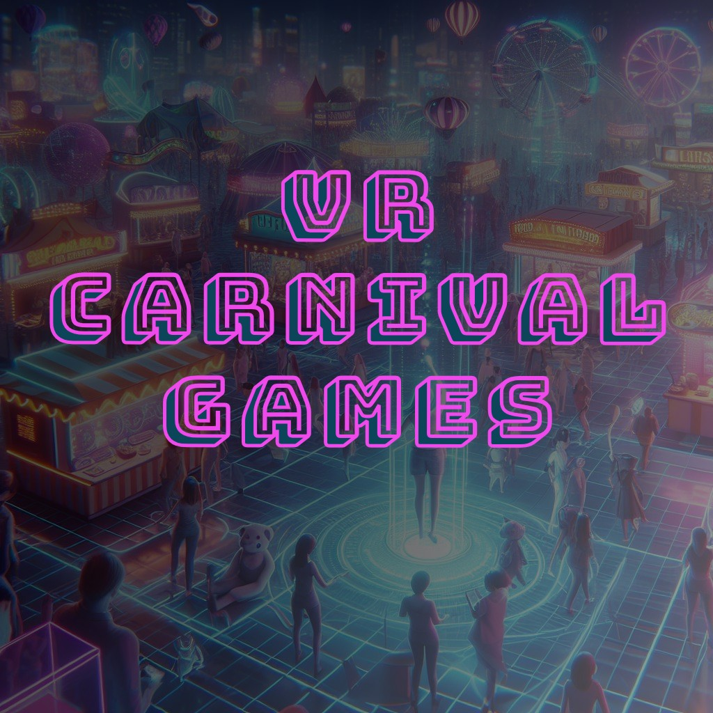

# VR Carnival Games

A Unity/C# VR prototype that recreates carnival games through grabbing, throwing, physical collisions, scoring, and resettable rounds.

[Gameplay clips and project overview](https://red-wave-026ab431e.3.azurestaticapps.net/vr_carnival)

## Games

- **Milk Bottle Toss:** throw baseballs at a stack of bottles.
- **Balloon Darts:** throw darts to pop balloons.
- **Box Toss:** bounce balls into scoring areas.
- **Frog Hop:** use a toy hammer to launch frogs toward lily pads.

The prototype includes freeplay and limited-attempt modes.

## Code highlights

- [BallInteractable](Assets/Scripts/BallInteractable.cs) extends `XRGrabInteractable` with grab/release handling and velocity-based audio.
- [MilkBottleTossGame](Assets/Scripts/MilkBottleTossGame.cs) coordinates item spawning, remaining throws, displaced-bottle scoring, and round resets.
- [BoxTossGame](Assets/Scripts/BoxTossGame.cs) and [FrogJumpGame](Assets/Scripts/FrogJumpGame.cs) implement the other minigame loops.
- Shared scripts handle collision detection, scoring feedback, and interactive objects.

## Open the project

1. Clone this repository and add its root folder through Unity Hub.
2. Open with **Unity 2022.3.7f1**, the version recorded in `ProjectSettings/ProjectVersion.txt`.
3. Allow Unity to resolve packages. The project uses **XR Interaction Toolkit 2.4.3**, **OpenXR 1.8.2**, and **URP 14.0.8**.
4. Open `Assets/Scenes/Start.unity`, the entry scene listed in Build Settings.
5. Use a compatible XR headset/runtime and review the project's XR settings for your target device before entering Play mode.

This is a prototype source project. The portfolio clips offer a quick preview without an XR setup; headset compatibility is not claimed for every device.

## Assets

The repository includes Unity samples and third-party assets alongside project scripts. Their respective licenses apply; these assets are not presented as original work.
